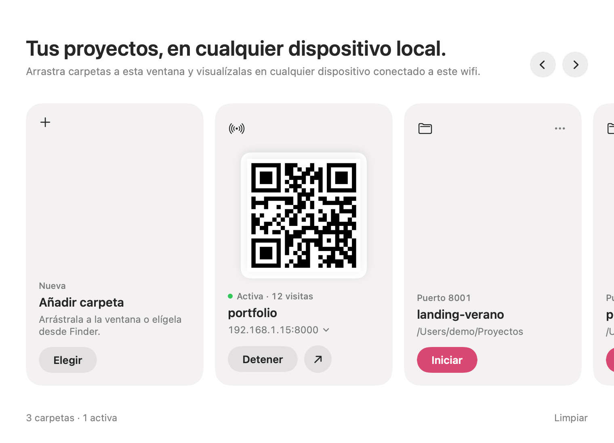

# Local Demo

App para macOS que sirve una o varias carpetas con webs estáticas y las comparte con cualquier dispositivo conectado a tu misma red (móvil, tablet, otro ordenador). Arrastras las carpetas, pulsas **Iniciar** y escaneas el código QR con el móvil, sin usar Terminal.



## Qué hace

- Añade carpetas arrastrándolas a la ventana o eligiéndolas desde la tarjeta «Añadir carpeta», una o varias a la vez.
- Muestra cada carpeta como una tarjeta en un carrusel horizontal, con su propio puerto (8000, 8001, 8002… por defecto, editables desde el menú «…»).
- Inicia y detiene cada carpeta por separado.
- Cuando una carpeta está activa, muestra su código QR, su dirección de red (por ejemplo `http://192.168.1.15:8000`) para copiarla y un botón para abrirla en el navegador.
- Avisa si un puerto ya está en uso, por otra carpeta o por otra app.
- Recuerda la lista de carpetas y sus puertos, y detiene todos los servidores al cerrar la ventana.
- Se adapta al modo claro y al oscuro.

## Requisitos

- macOS 14 (Sonoma) o posterior.
- Command Line Tools de Xcode, que incluyen `swiftc` y `python3`. Si no las tienes:

  ```bash
  xcode-select --install
  ```

## Compilar e instalar

1. Clona el repositorio y entra en la carpeta.
2. Ejecuta el script de compilación. Compila la app y la instala en `~/Applications`, sustituyendo la versión anterior si existe:

   ```bash
   ./build.sh
   ```

### Primera ejecución

- Si macOS pregunta si permites conexiones entrantes a Python, pulsa **Permitir**. Si no, los demás dispositivos no podrán conectarse.
- Los dispositivos deben estar en la misma Wi‑Fi. Algunas redes de invitados o corporativas bloquean el tráfico entre dispositivos.

## Cómo funciona

La app es una interfaz en SwiftUI sobre el servidor web que incluye Python. Cada carpeta lanza su propio proceso:

```bash
python3 -m http.server <puerto> --bind 0.0.0.0 --directory <carpeta>
```

| Archivo | Contenido |
|---|---|
| `LocalDemoApp.swift` | Toda la app: ventana, gestión del servidor, IP local y código QR |
| `logo.png` | Logo de la app |
| `make_icon.swift` | Convierte el logo en el icono de macOS (forma redondeada y margen) |
| `Info.plist` | Nombre, identificador y versión de la app |
| `build.sh` | Compila, genera el icono, firma la app en local y la instala en `~/Applications` |
| `docs/` | Capturas de pantalla para este README |

Para probar sin tocar la interfaz, define `LOCALDEMO_AUTOSTART=1` y la app empezará a servir todas las carpetas guardadas al abrirse.

## Licencia

[PolyForm Noncommercial 1.0.0](LICENSE.md). Puedes usar, copiar y modificar este proyecto con cualquier fin no comercial. No está permitido usarlo con fines comerciales.
